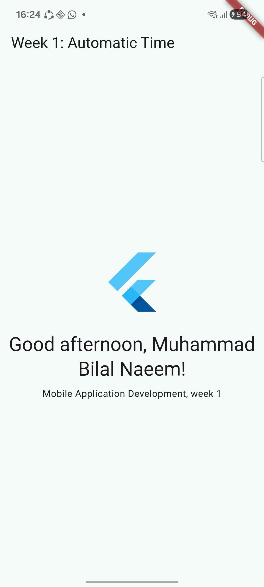

# Week 1: Hello Flutter

Mobile Application Development, Assignment 1: run your first Flutter app on your phone.

| | |
|---|---|
| Student | Bilal Naeem |
| GitHub | [bilal1211-sauce](https://github.com/bilal1211-sauce) |
| Repository | [week1_assignment_bilal-naeem](https://github.com/bilal1211-sauce/week1_assignment_bilal-naeem) |
| Starter code | Course template [hashirshoaeb/mad-01-hello-flutter](https://github.com/hashirshoaeb/mad-01-hello-flutter) |
| Phone | Samsung Galaxy A73 5G (SM A736B), Android 16 |
| Laptop | Windows 11 Pro, 64-bit |

## What the app does

The app shows the Flutter logo, a greeting for the time of day with my name (for example **Good afternoon, Muhammad Bilal Naeem!**), and the text "Mobile Application Development, week 1".

- **TODO 1:** `studentName` holds my name.
- **TODO 2:** `greetingFor(hour)` returns `Good morning` before 12, `Good afternoon` before 17, and `Good evening` for every other hour.

## My screenshot



## How to run

This project needs Flutter 3.50.0 or newer.

1. Connect an Android phone with a USB cable. USB debugging must be on.
2. In this folder, run:

   ```bash
   flutter pub get
   flutter run
   ```

The first build takes several minutes.

## Tests

```bash
flutter test
```

## My toolchain

| Tool | Version |
|---|---|
| Flutter | 3.50.0 (channel stable) |
| Dart | 3.14.0 |
| Git | 2.51.2.windows.1 |
| VS Code | 1.146.0 |
| Android SDK | 36.0.0 |
| Android NDK | 28.2.13676358 |

## Check results

### `flutter test`

```
00:03 +4: greetingFor(12) is Good afternoon
00:03 +5: greetingFor(17) is Good evening
00:03 +6: All tests passed!
```

### `flutter analyze`

```
<FLUTTER_ANALYZE_OUTPUT>
```

### `flutter doctor`

```
[√] Flutter (Channel stable, 3.50.0, on Microsoft Windows [Version 10.0.26300.9974], locale en-PK)
[√] Windows Version (Windows 11 or higher, 26H2, 2009)
[√] Android toolchain - develop for Android devices (Android SDK version 36.0.0)
[√] Chrome - develop for the web
[!] Visual Studio - develop Windows apps (Visual Studio Build Tools 2022 17.14.31 (April 2026))
[√] Connected device (3 available)
[√] Network resources
```

The Visual Studio line is only for Windows desktop apps. This course builds Android apps, so it doesn't matter here.

## Problems I hit and how I fixed them

1. **Gradle: "Timeout waiting for exclusive access to file".** A download that had stopped earlier left a lock behind. I closed every Java process, deleted the half-downloaded Gradle folder in `.gradle\wrapper\dists`, and ran the build again.
2. **Gradle: "An established connection was aborted".** My internet dropped during Gradle's own download, and that download can't resume. I ran it again on a steadier connection.
3. **"Android sdkmanager did not install NDK 28.2.13676358".** I installed NDK 28.2.13676358 myself, then the build passed.
4. **Spaces in the Flutter path.** My Flutter folder was in `D:\Mobile App Developer\`. Flutter's guide says not to use a path with spaces, so I moved it to a folder without spaces and updated my PATH.

## AI note

I asked Claude to explain my setup errors (Gradle download, NDK, PATH), and used Claude Code to fill in this README, take the screenshot over adb and push to GitHub; I wrote `studentName` and `greetingFor` myself.
